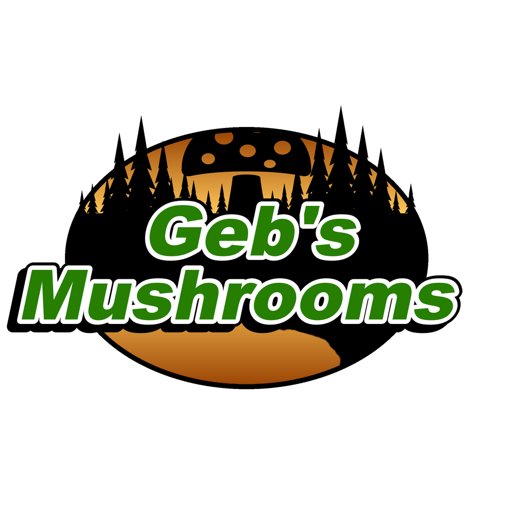

<h1 align="center">
   
  
   
  
   
</h1>

<h3 align="center">Wild Fungi for DayZ</h3>

  
  
  

  <a href="https://packjc.github.io/gebsmushrooms/">Website</a> •
  <a href="#key-features">Key Features</a> •
  <a href="#installation">Installation</a> •
  <a href="#main-classnames">Classnames</a> •
  <a href="#credits">Credits</a> •
  <a href="#license">License & Terms</a> •
  <a href='CHANGELOG.md'>Change Log</a>

## Information

Geb's Mushrooms adds 63 wild fungi to DayZ: 36 edible species and 27 poisonous look-alikes, each with its own model and its own baked, boiled, dried, burnt and rotten looks.
They grow on the forest floor near players, through the vanilla events that scatter mushrooms.

## Requirements

* DayZ 1.30. No other mods are needed: load Geb's Mushrooms on both the server and every client.

## Key Features

* **36 edible fungi**: black morel, white morel, lion's mane, giant puffball, chanterelle, chicken of the woods, hen of the woods, shaggy mane, hedgehog mushroom, honey mushroom, wood blewit, lobster mushroom, indigo milk cap, wine cap, velvet foot, beefsteak fungus, cauliflower mushroom, gem-studded puffball, bay bolete, orange birch bolete, old man of the woods, amethyst deceiver, fairy ring champignon, half-free morel, American Caesar, horse mushroom, St George's mushroom, dryad's saddle, bear's head tooth, matsutake, shaggy parasol, witch's butter, turkey tail, hemlock reishi, chaga and crown-tipped coral.
* **27 poisonous look-alikes**: death cap, destroying angel, false morel, jack-o'-lantern, common earthball, sulphur tuft, deadly webcap, green-spored parasol, panther cap, funeral bell, the sickener, yellow stainer, ivory funnel, brown roll-rim, devil's bolete, deadly dapperling, deadly fibrecap, livid pinkgill, false death cap, early false morel, yellow knight, poison pie, clouded agaric, bitter bolete, ringed conecap, stinkhorn and scaly vase chanterelle.
* **Real poisons**: poisonous species use DayZ's own illnesses. Most cause food poisoning (charcoal tablets help); the seven deadly ones cause heavy-metal-style organ damage that cooking doesn't prevent and only chelation tablets stop. Some edible species, like the morels, must be cooked first.
* **Server-controlled by design**: the fungi join the vanilla `Trajectory` events, sorted by habitat. Add only the species you want, or leave out the poisonous ones.
* Supported languages:
  - English
  - Czech
  - German
  - Russian
  - Polish
  - Hungarian
  - Italian
  - Spanish
  - French
  - Chinese (Traditional and Simplified)
  - Japanese
  - Portuguese
  > **Note**
  > Although supported languages are listed above, we cannot verify complete accuracy. If you are a native speaker and notice anything wrong, please reach out to us in the Discord via a ticket to assist us in getting proper translations.

## Installation

1. Subscribe to Geb's Mushrooms on the [Steam Workshop](https://steamcommunity.com/workshop/browse/?appid=221100&searchtext=Geb%27s+Mushrooms).
2. Install the published `@gebsmushrooms` folder beside the DayZ server executable.
3. Copy the included `.bikey` into the server's `keys` folder.
4. Add `-mod=@gebsmushrooms` to the server launch parameters. Every connecting player must load the same Workshop mod.
5. Give each fungus a `types.xml` entry like vanilla's `AgaricusMushroom`, and add it to the vanilla `Trajectory` events for its habitat.

The [server-owner guide](https://packjc.github.io/gebsmushrooms/#setup) walks through every step, with copy-ready XML.

## Main Classnames

| Category | Classnames |
| --- | --- |
| Edible fungi | `geb_AmericanCaesar`, `geb_AmethystDeceiver`, `geb_BayBolete`, `geb_BearsHeadTooth`, `geb_BeefsteakFungus`, `geb_BlackMorel`, `geb_CauliflowerMushroom`, `geb_Chaga`, `geb_Chanterelle`, `geb_ChickenOfTheWoods`, `geb_CrownTippedCoral`, `geb_DryadsSaddle`, `geb_FairyRingChampignon`, `geb_GemPuffball`, `geb_PuffBall`, `geb_HalfFreeMorel`, `geb_HedgehogMushroom`, `geb_HemlockReishi`, `geb_HenOfTheWoods`, `geb_HoneyMushroom`, `geb_HorseMushroom`, `geb_IndigoMilkCap`, `geb_LionsMane`, `geb_LobsterMushroom`, `geb_Matsutake`, `geb_OldManOfTheWoods`, `geb_OrangeBirchBolete`, `geb_ShaggyMane`, `geb_ShaggyParasol`, `geb_StGeorgesMushroom`, `geb_TurkeyTail`, `geb_VelvetFoot`, `geb_WhiteMorel`, `geb_WineCap`, `geb_WitchsButter`, `geb_WoodBlewit` |
| Poisonous fungi | `geb_BitterBolete`, `geb_BrownRollrim`, `geb_CloudedAgaric`, `geb_Earthball`, `geb_DeadlyDapperling`, `geb_DeadlyFibrecap`, `geb_DeadlyWebcap`, `geb_DeathCap`, `geb_DestroyingAngel`, `geb_DevilsBolete`, `geb_EarlyFalseMorel`, `geb_FalseDeathCap`, `geb_FalseMorel`, `geb_FuneralBell`, `geb_GreenSporedParasol`, `geb_IvoryFunnel`, `geb_JackOLantern`, `geb_LividPinkgill`, `geb_PantherCap`, `geb_PoisonPie`, `geb_ConocybeFilaris`, `geb_ScalyVase`, `geb_Stinkhorn`, `geb_SulphurTuft`, `geb_EmeticRussula`, `geb_YellowKnight`, `geb_YellowStainer` |

The complete searchable list of 63 public config classes is on the [project website](https://packjc.github.io/gebsmushrooms/#classnames).

## The Geb's family

This mod is one of three that used to be **Geb's Flora & Fauna**. Each now stands alone, so a server can run the ones it wants:

* [Geb's Animals](https://github.com/PackJC/gebsanimals) ([website](https://packjc.github.io/gebsanimals/)): 15 wildlife species
* [Geb's Plants](https://github.com/PackJC/gebsplants) ([website](https://packjc.github.io/gebsplants/)): 27 garden crops and wild ginseng
* [Geb's Mushrooms](https://github.com/PackJC/gebsmushrooms) ([website](https://packjc.github.io/gebsmushrooms/)): 63 edible and poisonous fungi

The classnames are unchanged. A server that ran Geb's Flora & Fauna should load all three to keep every item players already have; leaving one out deletes its items from the server's storage at the next restart.

## Credits

- Geb, creator and author
- The DayZ community for reporting bugs and inspiration throughout the life of the mod

## Support

If you like this project and think it has improved your server in any way, consider contributing! We are always looking for help with ideas, new models, and any monetary support that can help improve the mod. Open a ticket in the [Discord](https://discord.gg/G8uSGZ8yyf) to discuss how you can contribute, or report a bug on [GitHub](https://github.com/PackJC/gebsmushrooms/issues).

## License

[Attribution-NonCommercial-NoDerivatives 4.0 International](https://github.com/PackJC/gebsmushrooms/blob/master/LICENSE)

## Usage & Terms
This item is NOT authorized (strictly forbidden) for any of these conditions:
- posting on Steam, except under the Steam account Cole.
- hosting on any download server other than Geb's Mushrooms current workshop download.
- hosting on any launcher for distribution other than Geb's Mushrooms current workshop download.
- to be packaged in any form other than Geb's Mushrooms current workshop download.
- to create derivative works.

## PERMISSION IS NOT GRANTED FOR THIS MOD TO BE INCLUDED IN A "SERVER PACK" or "MOD PACK" DO NOT EVEN ASK TO REPACK. NO. NOT ALLOWED.
Use a Collection if you want to include this mod on your server for your users.

## Monetization
You are hereby given monetization approval under the conditions that you follow the DayZ Server Monetization agreement and have obtained permission from Bohemia. Read more here https://www.bohemia.net/monetization

## Donations
We accept donations at https://www.paypal.com/paypalme/packjc every dollar counts and we greatly appreciate any contributions!

### Copyright © Smoky Mountain Software 2022-2026
